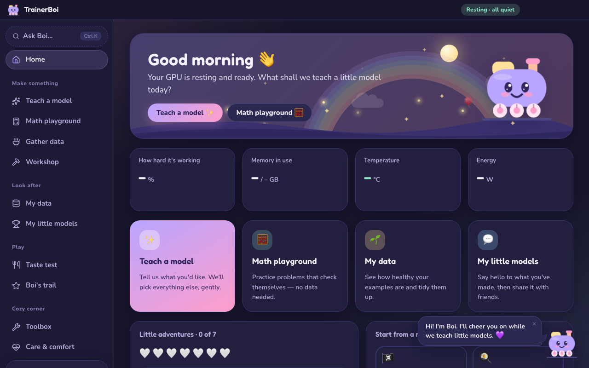
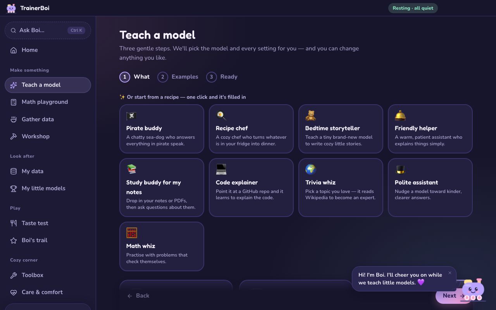
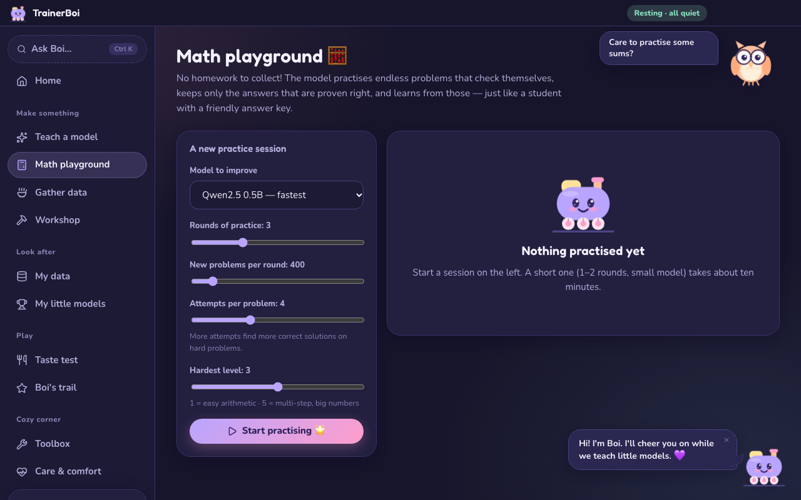

# 🚂 TrainerBoi - train your own AI on your own computer

**Open-source, local-first LLM training for everyone.** A desktop app for training and fine-tuning language models (and other ML models) on your own
NVIDIA GPU - no code, no cloud, no account. A beginner can get a good result in a few clicks; experts keep every setting.

* ✨ **Guided training** - pick a goal, drop in data (or none), and it chooses the model, method and settings, then shows a live run.
* 🧮 **Math Lab** - teach a model maths with no dataset: unlimited self-checking problems, learning only from verified answers.
* 📚 **Data tools** - paste links / repos / datasets / a topic, auto-quality grading (Data doctor), one-click cleaning.
* 🧭 **Many methods** - SFT, LoRA/QLoRA, DPO, ORPO, KTO, GRPO reinforcement learning, pretraining, verified self-improvement.
* 🏆 **Share** - chat with your model, then send a zip, publish to Hugging Face, or open a temporary public link.
* 🌸 **Calm and cute** - meet Boi, the little train: his eyes follow your mouse, he cheers milestones, blushes when you share, sweats when the GPU is toasty, and hops when you click him (double-click for a spin; the 💤 button lets him nap). A garden grows one flower per model; runs play out as a storybook journey (scenery scrolls past, signposts for each step, a cottage waiting at the end, rain if something goes wrong); Professor Hoot the owl and Biscuit the bunny cheer on maths and data; a sticker book and Boi's closet (hats!) reward real milestones; optional pixie-dust cursor trail; pages glide in and numbers count up. Two themes (night / day), optional little sounds (the bell), gentle words.
* 🛡️ **Safe by default** - local-only server, hot-GPU protection, no tokens stored. See [SECURITY.md](SECURITY.md).

## Install

**Windows desktop installer** *(recommended)* - download `TrainerBoi Setup x.y.z.exe` from the Releases page. On first launch it detects your GPU and
installs Python + the matching PyTorch for you (5-15 min, one time). Windows may show a SmartScreen warning for unsigned builds.

**From source** (needs [uv](https://docs.astral.sh/uv/) and Node 20+; an NVIDIA GPU is strongly recommended):

```powershell
git clone https://github.com/CloudCorpRecords/trainerboi.git
cd trainerboi
setup.bat        # Python 3.11 env + PyTorch for your GPU + libraries + UI
START.bat        # opens http://127.0.0.1:7860     (or launch_desktop.bat for the Electron app)
```

## Get involved

TrainerBoi is open to contributors of every level, including first-timers.

* ⭐ **Star the repo** to follow along, or **Watch → Releases** to hear about new versions.
* 🐣 **First PR?** Pick a [good first issue](https://github.com/CloudCorpRecords/trainerboi/labels/good%20first%20issue) and read [CONTRIBUTING.md](CONTRIBUTING.md). UI and docs work don't need a GPU.
* 💬 **Questions, ideas, or a model you're proud of?** Share it in [Discussions](https://github.com/CloudCorpRecords/trainerboi/discussions).
* 🐛 **Something broke?** [Open an issue](https://github.com/CloudCorpRecords/trainerboi/issues/new/choose) with your GPU and the technical log.

Licensed under the [MIT License](LICENSE). Models you train keep the licence of their base model (shown on the model card).

---

## The app at a glance

A native-feeling desktop app (Electron + React) on top of a Python backend. Everything the GPU does runs in separate processes, so the window stays smooth.







| Screen | What it does |
|---|---|
| **Home** | Live GPU activity, memory, temperature and power straight from the NVIDIA driver, what's running now, recent models and activity. |
| **New training** | 3 steps - goal → data (drop files, paste links / repos / datasets / a topic) → time. Shows the plan and why, then a **live run view**: step-by-step progress, learning curve, samples, GPU readings, before/after answers, automatic recovery from GPU errors. |
| **Math Lab** | Teach a model maths with no dataset (see [Math Lab](#math-lab)), with per-skill before/now accuracy. |
| **Data** | Every dataset with an A-F quality grade; analyse it and create a cleaned copy in one click (Data doctor). |
| **My models** | Everything you trained: chat with it (streaming), then share - **zip**, **Hugging Face**, or a **temporary public chat link** - with an auto-written model card; rename, notes, delete. |
| **Advanced tools** | The full classic studio embedded: dataset builder + library, AI generator, manual training with every setting, methods guide, auto-tune, compare, export (GGUF/Ollama), AutoTrain, classic trainers, RAG, audio. |
| **Settings & health** | Safety pause temperature, GPU health check (finds hot-GPU calculation errors), computer facts. |

### Fun and easy extras

* **Recipes** - one click fills in a whole training (Pirate buddy, Study buddy, Code explainer, Trivia whiz, Bedtime storyteller…), and runs get silly names like `fluffy-otter-42`.
* **Gather data** (the data kitchen) - drop files or paste links / repos / datasets / a topic; watch it cook; one click to check its health or teach a model with it.
* **Workshop** - every training method (SFT, LoRA, DPO, ORPO, KTO, RL, from scratch) with a friendly picker, a 'which one?' quiz, 'suggest cozy settings', and every knob.
* **Taste test** - ask two models the same question side by side, including a model against its own before-training self.
* **Ask Boi** (`Ctrl K`) - type what you want ('math', 'pirate', 'share', 'joke') and jump straight there; plus *Little adventures* - a gentle checklist that earns stickers and hats.
* **Boi's trail** - stickers, a friendly rank (Seedling → Starlight) and a count of cozy days you've dropped by (it only ever goes up). Milestones unlock real **tricks**: *Teach-back* (rate or fix a chat answer and it's saved as a lessons dataset you can train on), *birth certificates* for your models, and the advanced Workshop methods. No money, no streaks to lose, all stored locally - and **Care & comfort → Open everything** unlocks it all if you'd rather skip ahead. Add your own trick in `ui/src/rewards.js` (`PERKS`).
* **Take it anywhere** - a model's Share tab can pack a folder with a ready-made Ollama Modelfile and a double-click launcher (LM Studio can open the same folder).

Architecture: `studio_server.py` (FastAPI) serves `ui/dist` (React, built with Vite), a JSON API over the existing Python modules, and mounts the classic
Gradio studio at `/classic`. `hw_info.py` is the torch-free hardware/job monitor that keeps the status readings fresh and accurate.
Develop the UI with `cd ui && npm install && npm run dev` (proxies the API to :7860); build it with `npm run build`.

Also: an OpenAI-compatible API server (`launch_api.bat`, http://127.0.0.1:8000/v1) and a terminal menu (`python train_cli.py`).

---

## Getting data (the easy part)

* **Add anything** (Guided training, step 2): paste links, YouTube / GitHub / Hugging Face / arXiv references, file or folder paths, or just a **topic**
  (`data_intake.py` routes each line to the right source, then inspects your files and suggests the goal and method).
* **Sources** (Data → Build, or `dataset_builder.py`): Hugging Face streaming, parallel web crawler (sitemaps, retries, canonical-URL dedup, robots.txt),
  Wikipedia (titles / `search:` / `category:`), arXiv, GitHub repos (no git needed), YouTube transcripts (Whisper fallback), and local files
  (txt, md, pdf, docx, pptx, epub, html, csv, xlsx, json, jsonl, parquet, 40+ code languages, zip, OCR for scans).
* **Pipeline:** auto-classify (chat / instruction / preference / raw text) → clean (unicode repair, quality rules, MinHash dedup, optional PII redaction)
  → token-aware chunking → optional **synthetic Q&A** (answers must be grounded in the source passage) → shuffle, split, sharded Parquet/JSONL. Builds resume.
* **Data doctor** (Library → *Data doctor*, `data_analyzer.py`): grades a dataset A-F; finds AI boilerplate, placeholders, truncated/looping answers,
  garbled text, language mismatch, duplicates, conflicting answers, train/test leakage, low variety, PII; makes a cleaned copy in one click.
  Quality rules are shared with the builder (`data_quality.py`).
* **Library:** explore any size dataset, search (text/regex), edit rows (staged, committed in one pass), stats, mix/oversample, convert JSONL ⇄ Parquet, zip, push to the Hub.

```powershell
python dataset_builder.py --name docs --url https://fastapi.tiangolo.com/ --sitemap --max_pages 100
python dataset_builder.py --name code --hf iamtarun/python_code_instructions_18k_alpaca --max_rows 15000
python dataset_builder.py --name repo --github pallets/flask --format sft --synthetic
python dataset_store.py mix --name blend --part alpaca:20000 --part mydocs:0 --dedup
python data_analyzer.py clean --name blend --out blend-clean --drop ai_boilerplate,truncated --dedup_prompts
```

---

## Training methods

| Method | Script | Needs |
|---|---|---|
| Fine-tuning (SFT; LoRA / QLoRA / full) | `train_llm_sft.py` | question→answer or chat data |
| Preference tuning (DPO) | `train_llm_dpo.py` | prompt + chosen + rejected |
| ORPO (teach + polish in one run) | `train_llm_orpo.py` | same pairs as DPO |
| KTO (thumbs up / down) | `train_llm_kto.py` | prompt + answer + good/bad label (pairs are converted) |
| Reinforcement learning (GRPO) | `train_llm_grpo.py` | questions + a checker (`math`, `concise`, `format`, `keywords`, or your own) |
| Pretraining from scratch | `pretrain_llm.py` | raw text |
| Verified self-improvement | `math_lab.py` | nothing |

Helpers: `chat_llm.py`, `merge_lora.py`, `llm_data.py`. Every script streams live telemetry to `<output_dir>/live/` so the Live tab can watch CLI runs too.

```powershell
python train_llm_sft.py --model Qwen/Qwen2.5-1.5B-Instruct --dataset yahma/alpaca-cleaned --max_steps 500
python train_llm_dpo.py --model runs/sft/merged --dataset trl-lib/ultrafeedback_binarized --max_steps 300
python train_llm_grpo.py --dataset math_gym --reward math --levels 1-3
python chat_llm.py --model runs/sft/final
```

**What fits in 16 GB** (seq 2048, rough): QLoRA up to ~8B, LoRA bf16 up to ~3B, full fine-tune up to ~0.5B, pretraining from scratch up to ~150M.

### Making training easy
* **Live training → ✨ Use recommended settings** (time budget → model, steps, learning rate, batch, length, with reasons).
* Pre-flight checks (dataset, model, GPU busy, disk) and **plain-English errors** (`friendly_errors.py`: out of memory, hot GPU, gated model, offline, disk, NaN…).
* Guided training retries after out-of-memory (smaller steps) and GPU errors (cool-down + resume).

### GPU safety
Laptop GPUs can silently compute wrong results when very hot (we measured this at ~86 °C on the RTX 3080 Ti Laptop). `gpu_guard.py` pauses training
at 82 °C (`TB_MAX_GPU_TEMP`, 0 = off) and resumes when cooler; Guided training and Math Lab also restart from the last checkpoint/round after a GPU error.
Run *Guided training → Check my GPU* once. Hardware fixes help most: cooling pad, Balanced power mode, no overclock, clean fans.

---

## Math Lab

`math_gym.py` generates unlimited maths problems (17 skills, 5 levels) **with their exact answers** and checks replies robustly
(`\boxed{}`, `####`, fractions, decimals, commas, %). `math_lab.py` runs rounds of **verified self-improvement**:
exam the model → write new problems aimed at its weakest skills → sample several attempts each → keep only attempts a checker proves correct
(shortest first) → fine-tune on them, merge, repeat. No dataset, no human labels, no teacher model.

Smoke test (Qwen2.5-0.5B-Instruct, 2 tiny rounds, 34-question exam): 44% → 62%; answers in `\boxed{}` 59% → 76%. Small sample: it shows the loop works,
not a benchmark - run bigger rounds for real numbers. RL variant: `python train_llm_grpo.py --dataset math_gym --reward math`.

**Beyond maths:** anything you can check with code (SQL that returns the right rows, JSON matching a schema, code that passes your tests, your company's
answer format) trains the same way: write a checker (`custom_reward_example.py`) and run
`python train_llm_grpo.py --reward custom --reward_file my_checker.py --dataset my_questions.jsonl`.
Not built yet: program-aided maths (model writes Python that is executed), learning from failed attempts (contrastive pairs), a library of shared checkers.

---

## Desktop app

* **Small installer (~90 MB).** First launch detects the GPU, downloads Python 3.11 and the matching PyTorch (CUDA 13.0 / 12.8 / 12.6 or CPU), then the libraries,
  with a progress screen. Lives in `%APPDATA%\TrainerBoi` (runs and datasets in its `workspace` folder).
* **Develop:** `cd desktop && npm install && npm start` (reuses the project's `.venv`; build the UI once with `cd ui && npm install && npm run build`). **Build:** `npm run dist` (builds the UI, stages the app, packs the installer) → `desktop/dist/TrainerBoi Setup <version>.exe` (needs Node 20+ and `uv` on the PATH).
* **Release:** `npm run dist:release` - set `TB_UPDATE_URL` (folder hosting `latest.yml` + installer) for auto-update and `CSC_LINK` / `CSC_KEY_PASSWORD` to sign.
  Unsigned builds trigger SmartScreen warnings. Signing needs a machine where symlinks are allowed (Developer Mode or CI).
* Bump `SETUP_VERSION` in `desktop/main.js` when `requirements-app.txt` changes. Menu: *TrainerBoi → Repair installation*. Logs: `desktop.log`, `studio.log`.
* `TB_PORT` / `TB_NO_BROWSER=1` run the Studio headless on a chosen port.

---

## Reference

**Stack:** PyTorch 2.14.1 + CUDA 13.0, Transformers 5.17, TRL 1.13 (ORPO from `trl.experimental`), PEFT 0.21, Unsloth, Triton (Windows), Liger Kernel,
bitsandbytes, W&B / TensorBoard. Pre-upgrade package list: `env_backup/`.

**Windows notes:** flash-attn / xformers / DeepSpeed / vLLM have no working builds for this torch - PyTorch SDPA + Unsloth kernels are used.
`uv pip check` says liger-kernel wants `triton`; expected (`triton-windows` provides it).

**Handy commands**

| Task | Command |
|---|---|
| Diagnostics | `python check_environment.py` |
| GPU speed test | `python -c "import trainer_utils; print(trainer_utils.benchmark_gpu())"` |
| GPU health (hot-GPU errors) | `python gpu_guard.py --check 150` |
| Tabular / Vision / QLoRA demos | `train_tabular.py`, `train_vision.py`, `train_llm_qlora.py` |
| Jupyter | kernel **Python (trainerboi GPU)** |

**Hardware this was developed on:** RTX 3080 Ti Laptop (16 GB, Ampere), i9-12900H, 32 GB RAM, ~37 TFLOPS FP16.
